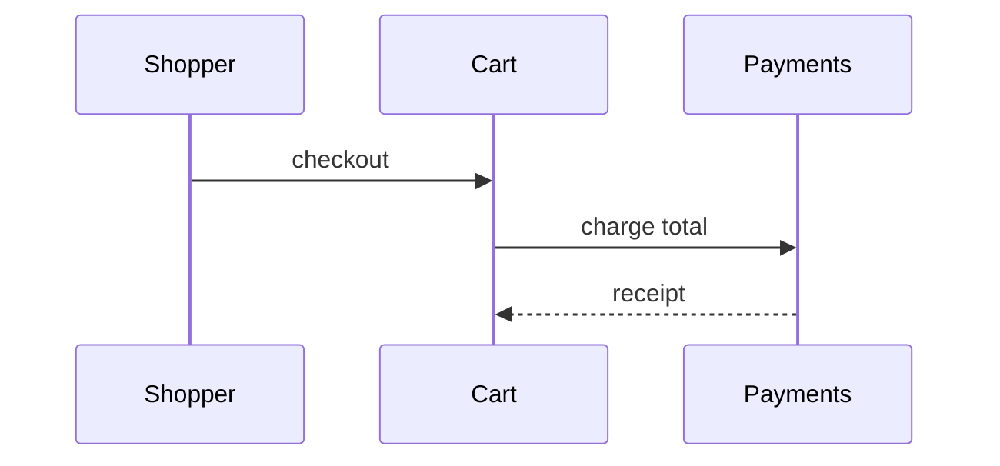

Use this template for writing the PR body:

```markdown
## Summary

<diagram, diff-sketch, or tree>

## Evidence

- **Before:** <screenshot/output/failing test run>
 **After:** <screenshot/output/passing test run>

## Merge Danger

**Door:** <one-way or two-way>

<optional: description>

**Blast Radius:** <one-word description>

<optional: potential ramifications of merge>
```

## Sections

Skip all preambles and keep prose brief. Use the user's domain language from `GLOSSARY.md`.

### Summary

One picture beats a paragraph. Choose the single lens that carries the point, and only that one.

- **Pseudocode** for logic or an algorithm the reviewer must hold in their head:

```text
on(checkout)
 if cart is empty
 reject "nothing to buy"
 reserve inventory
 charge payment
```

- **Call tree** for runtime control flow (who calls whom, in order):

```text
checkoutCart
 validateCart
 reserveInventory
 lockStock
 chargePayment
```

- **Component tree** for UI structure, include state hooks and the owning module when it matters:

```text
<CheckoutPage> (apps/shop/src/routes/checkout.tsx)
 useCart()
 <OrderSummary>
 <PaymentForm> (packages/payments)
```

- **File tree** for ownership or a broad refactor, shallow, with a one-line note on what each directory owns:

```text
src/
├── cart/ # cart state and validation
├── inventory/ # stock reservation
└── payments/ # charging and refunds
```

- **Mermaid** for anything with interaction over time (sequences, flows, state):



- **Diff sketch** when the shape already exists and the point is what moved. Mirror the diff to the topic, component diffs for component changes, tree diffs for layout changes, pseudocode diffs for logic changes:

```diff
 checkoutCart
 validateCart
+ applyCoupon
 reserveInventory
- chargePayment
+ chargePayment
+ recordCouponUsage
```

- **Full block** when most of the code is new, when trimming context would hide who owns what or what runs first, or when the reviewer needs something copyable:

```ts
function applyCoupon(cart: Cart, code: string): Cart {
 const coupon = lookupCoupon(code);
 return { ...cart, discount: coupon.percentOff };
}
```

#### How to place them

Put each visual right beside the sentence it explains. Strip everything the reviewer doesn't need for this PR's question, extra calls, files, props, and states are noise. One lens is usually enough; two at most. Never use all of them.

### Evidence

Concrete evidence that the change works. Show a before and after.

Screenshots are S-tier - when the environment is set up for it and the change is visual.

Execution-based evidence is A-tier. Test results, console output. Show the exact test that now fails and passes, using pseudocode.

### Merge Danger

Describe whether it's a one-way or two-way door. You can walk back through two-way doors, but not one-way doors. A PR that is cheap to roll back is lower risk. Changes that involve destructive actions or hard-to-reverse decisions are one-way doors.

The blast radius is the potential impact or scope of the changes introduced by this PR. Consider all possibilities. Examples are layout shift, breakages for consumers, mobile responsiveness, etc.
